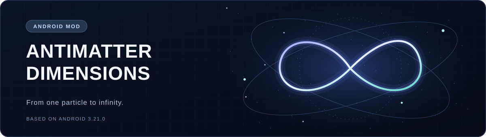
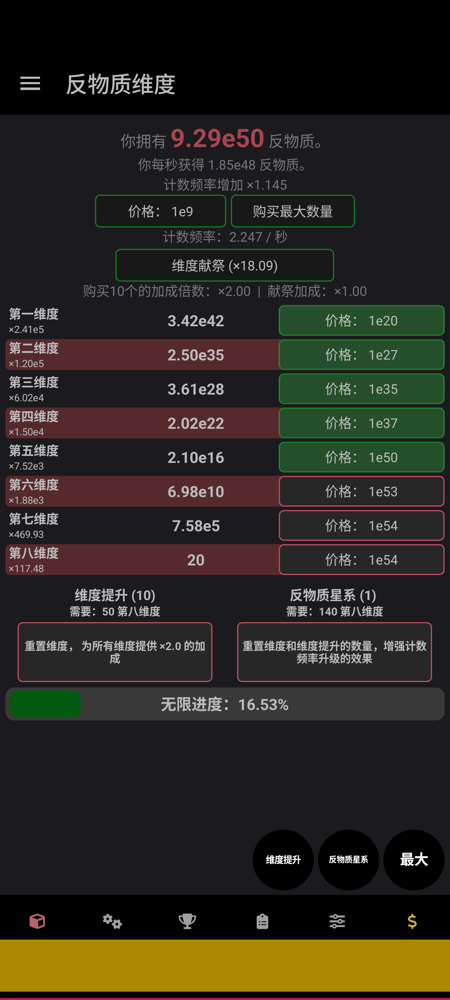
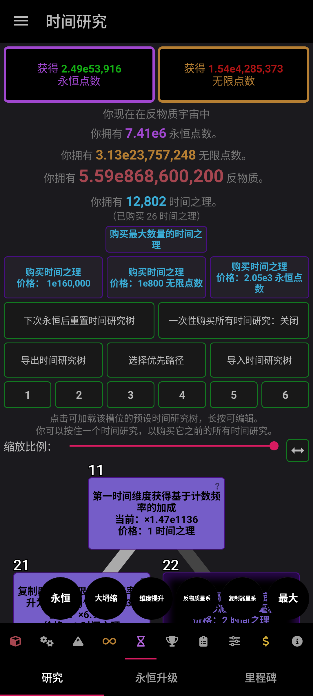

<p align="center">
  
</p>

<h1 align="center">反物质维度 MOD · Android</h1>

<p align="center"><strong>把无限装进口袋。</strong></p>
<p align="center">从一份反物质开始，让每一次重置打开新的成长空间。</p>

<p align="center">
  <a href="https://github.com/OrekiDawson/AD-Oreki-Edition-Android/releases"><strong>下载 Android 版</strong></a>
  &nbsp;·&nbsp;
  <a href="https://oreki.net/">在线游玩</a>
  &nbsp;·&nbsp;
  <a href="https://wiki.oreki.net/player/">玩家指南</a>
  &nbsp;·&nbsp;
  <a href="https://wiki.oreki.net/">中文 Wiki</a>
</p>

<p align="center"><sub>原版兼容基线 3.21.0 · Kotlin · 持续开发中</sub></p>

---

## 从一份反物质，到整个宇宙

第一次大坍缩之后，反物质消失了，新的成长空间却打开了。《反物质维度》的有趣之处，就在于一次次看似倒退的重置会带来更强的增长。

本 MOD 基于原版 Android 3.21.0，以 Kotlin 扩展自动化、成长节奏与移动端体验。少一点重复点击，多一点发现新机制的时间。

<p align="center"><strong>反物质　→　无限　→　永恒　→　现实　→　天神</strong></p>

## 游戏一瞥

<p align="center">
  
  &nbsp;
  
</p>
<p align="center"><sub>左：从零开始　　右：时间研究树<br>2026 年 11 月 12 日的开发候选界面，仅作玩法示意，并非最新发行版截图。</sub></p>

## 有什么不同？

| 玩法 | 设计方向 |
| :--- | :--- |
| **智能自动化** | 调度器统一管理自动购买器。托管开启时，玩家修改将在下一有效 tick 按策略恢复；关闭 MOD 总开关则停止托管。间隔 1～60 秒，默认 10 秒。 |
| **成长节奏** | 按阶段调优，减少无意义等待，而不是把重要机制一闪而过。 |
| **移动端体验** | 简体中文教程、MOD 设置与更少的无意义切页；保留有趣的手动操作。 |
| **真实的数字** | 保留原版合法购买、解锁、挑战和结算。不凭空发放资源、成就或通关记录。 |

约 180 分钟合法通关是双端新档的开发验收目标，并不是每个版本、设备或存档的保证。具体实现及已知问题以实际发行说明为准。

## 开始游玩

1. 在 [GitHub Releases](https://github.com/OrekiDawson/AD-Oreki-Edition-Android/releases) 选择适合的 Android APK，阅读发行说明并对照提供的 SHA-256。
2. 更新或迁移之前，先导出并妥善保存游戏存档。
3. 安装并开始游玩；需要了解机制、研究路线或存档操作时，打开 [玩家指南](https://wiki.oreki.net/player/)。

> 预发布版（Pre-release）用于测试新功能与收集反馈，不等同于稳定版。请先备份存档，并留意发行说明中的已知问题。

不想安装 APK？[浏览器版](https://oreki.net/) 也可作为另一种游玩入口。两个平台的存档载体与兼容性以实际验证为准。

---

## APK 是怎样长出来的？

原版游戏兼容基线与 Kotlin MOD 代码通过 Android Gradle Plugin 构建为可安装 APK。源码恢复与兼容迁移仍在持续，反编译结果并不等同于完整、可运行的源码。

本地构建需要 JDK、Android SDK、Build Tools 与相应的官方游戏构建输入。详细前置条件及机器专属配置请先阅读 [构建与交付说明](docs/DELIVERY_RULES.md)。

Linux 环境下，在仓库根目录运行（已具备所需构建输入后）：

```bash
./gradlew :app:assembleRelease --no-daemon
```

缺少正式输入时应明确构建失败，而不是产出替代游戏的桥接包。编译成功也不代表游戏或发行验收已经通过。

<details>
<summary><strong>展开工程结构与其他平台命令</strong></summary>

| 路径 | 内容 |
| --- | --- |
| `app/src/main/kotlin/` | MOD 业务与原版接口适配 |
| `app/` | Android 应用模块 |
| `build-logic/` | 构建输入、资源与工程检查 |
| `baseline/` | 官方基线资料 |
| `scripts/` | 辅助工具与定向验证 |
| `docs/` | 技术与交付资料 |

macOS 同样可使用 `./gradlew :app:assembleRelease --no-daemon`。Windows PowerShell 7：

```powershell
.\gradlew.bat :app:assembleRelease --no-daemon
```

机器专属输入路径按构建与交付说明及 `local.properties` 配置。

</details>

## 一起研究游戏

| 想了解什么？ | 从这里出发 |
| :--- | :--- |
| 玩法与入门 | [玩家专区](https://wiki.oreki.net/player/) |
| Android 架构、构建与源码恢复 | [开发者 Wiki](https://wiki.oreki.net/developer/) |
| 另一种实现 | [Web 源码](https://github.com/OrekiDawson/AD-Oreki-Edition-Web) · [双端差异](WEB_ANDROID_DIFFERENCES.md) |
| 参与开发 | [事实索引](docs/FACTS.md) · [协作规则](AGENTS.md) |
| 遇到问题 | [提交 Issue](https://github.com/OrekiDawson/AD-Oreki-Edition-Android/issues)，附上版本、设备、复现步骤与脱敏日志 |

## 原版与许可

感谢 [Antimatter Dimensions 上游](https://github.com/IvarK/AntimatterDimensionsSourceCode) 的作者及贡献者。本项目为非官方 MOD。Android 原版、MOD 代码及第三方素材的权利边界以各自的原始许可、发行资料和 [版本说明](https://github.com/OrekiDawson/AD-Oreki-Edition-Android/releases) 为准；本仓库没有统一的根级 MOD 许可证可供推定额外授权。

---

<p align="center"><em>下一次重置，或许就是下一次发现。</em></p>
